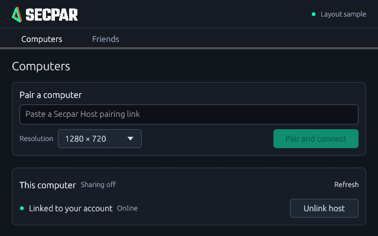

# Secpar

A fork of [PC Remote](https://github.com/SadikTD/pc-remote) for docked Android use and a growing desktop app family. Secpar focuses on physical keyboard/mouse input, resolution handling and compact, plain interfaces. Android stays client-only. Desktop hosting and connecting on Windows, Linux and macOS is the target; the current platform limits are listed below.

## Desktop Development 4

Native development clients for the existing Windows Secpar Host:

[Windows x64](https://github.com/modnite/Secpar/releases/download/v0.1.0-secpar-desktop-dev.4/Secpar-Desktop-dev4-windows-x64.exe) · [Linux x64](https://github.com/modnite/Secpar/releases/download/v0.1.0-secpar-desktop-dev.4/Secpar-Desktop-dev4-linux-x64.tar.gz) · [Mac Apple Silicon](https://github.com/modnite/Secpar/releases/download/v0.1.0-secpar-desktop-dev.4/Secpar-Desktop-dev4-macos-arm64.tar.gz) · [Mac Intel](https://github.com/modnite/Secpar/releases/download/v0.1.0-secpar-desktop-dev.4/Secpar-Desktop-dev4-macos-x64.tar.gz)

Development 4 adds consistent control heights and center lines, aligned page/panel keylines, flat navigation, restrained tonal surfaces and a more structured Friends list. Account/friend management, secure saved pairing and local host account linking from the previous build are retained. Video uses software H.264 decoding, with Opus audio, physical keyboard/mouse capture and Ctrl+F12 release. Friend access to a PC, Linux/macOS hosting and multiplayer are still unfinished. See the [release notes](https://github.com/modnite/Secpar/releases/tag/v0.1.0-secpar-desktop-dev.4) and [desktop implementation/validation limits](desktop/README.md).

The optional [compact Windows Host installer](https://github.com/modnite/Secpar/releases/download/v0.1.0-secpar-desktop-dev.3/Secpar-Host-desktop-dev3-setup.exe) keeps pairing and navigation visible with long device lists, supports the new account-link flow and correctly links to development downloads. Pairing and settings fit at 640×400, with resizing and QR enlargement. It updates Secpar Host and can interrupt an existing Secpar stream; do not install it through your only remote connection. It does not replace PC Remote.

Apple Silicon is cross-compiled on an Intel Mac because GitHub's native ARM pool
could not supply a runner. Its ARM64 executable, bundle metadata and ad-hoc signature
were checked; native execution and hardware streaming are still unverified.

Screenshots show rendered interfaces. This image is explicitly a layout sample, not a live user session. [More screenshots and review details](docs/ui-review.md).

## Android Preview 11

[Android APK](https://github.com/modnite/Secpar/releases/download/v3.0.3-secpar-preview.11/Secpar-preview11.apk) · [Previous Windows host installer](https://github.com/modnite/Secpar/releases/download/v3.0.3-secpar-preview.10/Secpar-Host-preview10-triangle-setup.exe) · [Preview 11 release notes](https://github.com/modnite/Secpar/releases/tag/v3.0.3-secpar-preview.11)

Android supports docked keyboard/mouse, cursor capture/release, trackpad fallback, remote pairing links and revised resolution handling. It uses the approved rounded mint/orange triangle. The Android package identity remains compatible with this fork's earlier previews. Preview 11 adds a docked/wide two-column Home layout, compact mode controls, matching Material button heights and consistent mint/orange accents. Phone and wide-window layouts were reviewed in the emulator. Account/friend integration and physical Galaxy S23 scanner validation remain unfinished. See [Android fork changes](docs/dock-input.md).

These are prereleases, installed manually. Android is debug-signed; Windows builds are unsigned; Mac development bundles are ad hoc signed and not notarized. GitHub's latest-stable endpoint excludes prereleases, so use these direct download links or the repository's Releases page.

## Current capabilities and limits

- **Windows host:** native capture and GPU encoding, audio, input, file/clipboard transfer, optional power and lock-screen controls, and direct/relay routing. The existing engine still has one active stream.
- **Android:** client-only. Physical input and trackpad fallback are retained. Account/friend integration is not implemented yet.
- **Desktop clients:** experimental Windows, Linux and Mac clients, local/remote owner pairing, native rendering, software decode and account/friend management. Real hardware and network validation remains incomplete. Only the last paired computer is currently remembered.
- **Accounts:** email/password registration, verification and browser sign-in are live at [accounts.secpar.win](https://accounts.secpar.win/auth/sign-in) and were confirmed by the user. No passkey or biometric requirement. Native Windows sign-in was also user-confirmed; friend actions and Linux/Mac native sign-in still need real-user validation.
- **Friends and sharing:** explicit friendship is separate from permission to use a PC. The API supports guest requests, permission subsets and short-lived admission grants, and cryptographically proven Windows host enrollment is implemented. Host guest admission and permission enforcement remain unfinished. No friend Connect button or multiplayer claim is presented before that works.
- **Linux/macOS hosts and unified desktop hosting/client UI:** not implemented yet. All nine desktop host/client combinations remain the target.

Secpar Host has separate service, ports, protected storage and installer identity from PC Remote. Existing remote profiles can continue using the original rendezvous relay. The Secpar account service does not carry the video stream. Our own relay is reserved for a later migration; switching one side prematurely can strand existing pairings.

The project descends from Moonlight/Sunshine work, but its current PRS streaming engine directly uses Windows capture, encoding, service and input APIs. Portable protocol/client libraries exist; Linux/macOS hosting still requires platform-specific implementation. See the [architecture](docs/desktop-expansion.md) and [delivery record](docs/delivery-status.md).

## Build

- **Android:** Android SDK and a compatible JDK; `./gradlew :app:assembleNonRootRelease`.
- **Windows host:** Rust/MSVC, Node and Visual Studio C++ build tools; run `npm ci` and `npm run tauri build` in host. [Host instructions](host/README.md).
- **Desktop clients:** Rust, C/C++ tools and CMake; `cargo run --manifest-path desktop/Cargo.toml`. Linux additionally needs audio, window-system and DBus development libraries. [Desktop instructions](desktop/README.md).
- **Account service:** Cloudflare Workers + D1 and a verified email sender. [Setup and security boundaries](cloud/accounts/README.md).
- **Rendezvous service:** [Protocol and configuration](docs/remote-protocol.md). Production endpoint migration and TURN provisioning remain separate work.

Windows and Linux CI use dedicated self-hosted runners; Mac builds use GitHub runners. Test success is not a claim that every hardware/platform combination is supported. Avoid testing a new host/client pairing through your only active remote session.

Protocol references: [control](docs/protocol.md), [stream](docs/stream-protocol.md), [remote access](docs/remote-protocol.md).

## License and attribution

GPL-3.0. Original project: [SadikTD/pc-remote](https://github.com/SadikTD/pc-remote). Secpar retains upstream attribution and documents fork changes separately. Secpar is an independent project.
