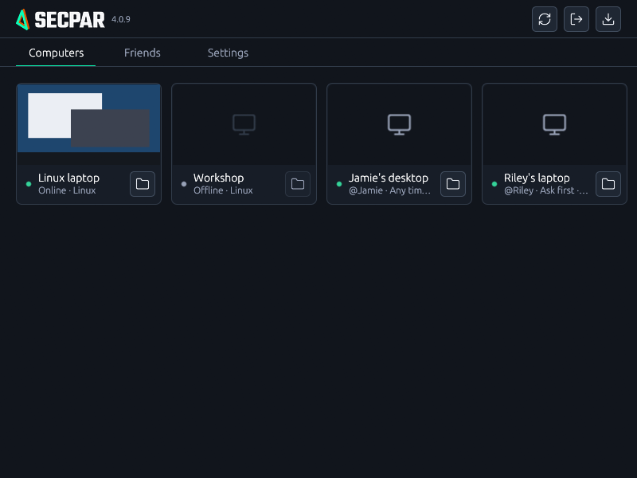

# Secpar

Remote desktop for Windows, Linux and Android. Sign in with the same account on each device and your computers appear in the app, ready to connect. Secpar started as a fork of [PC Remote](https://github.com/SadikTD/pc-remote).

## Download

[secpar.win](https://secpar.win/#downloads) or the [latest release](https://github.com/modnite/Secpar/releases/latest), which also lists checksums.

| | Package | Role |
|---|---|---|
| Windows 10 and 11 | `Secpar-Windows-x64-setup.exe` | Host and client |
| Linux x86-64 | `Secpar-Linux-x64.AppImage` | Host and client |
| Android and Android TV | `Secpar.apk` | Client |

Each package is one app. On Windows and Linux the same app hosts this computer and connects to others. The apps check for updates and install them when you choose to.

## What it does

- **Computers.** Every computer signed in to your account, with a still of its screen and who is using it. Paired devices are listed beneath, with Disconnect and Remove. Connect directly on your network or across the internet, or through Secpar's relay when a direct route is blocked. Up to three devices can stream from one computer at once.
- **Friends.** Add people by username and select their computers to connect. For each friend, choose Ask first or Any time, and allow keyboard, mouse and file browsing separately; Ask first needs one approval, from the notification or the app. Keyboard and mouse changes reach a connected friend within seconds. Friends are kept on your account, so they follow you to every device.
- **Files and clipboard.** Browse a computer's files and copy them either way. Copied text is shared while you are connected.
- **Screens.** Switch between a computer's screens from the stream menu, or open another screen in its own window. On Windows, a virtual display adds a screen for a computer with no monitor, at the size you pick in Settings › This computer.
- **Full colour.** Full colour (4:4:4) in Settings › Streaming keeps coloured text sharp, for about twice the video.
- **Relay.** When a network blocks the relay's usual UDP traffic, Secpar reaches it over TLS on port 443.
- **Lock screen.** You can sign in at a locked Windows or Linux computer from your own devices. Friends cannot.
- **Sound and controllers.** The computer's sound plays on the connecting device, and controllers attached to that device work on the computer.
- **Power.** Lock, sleep, sign out, restart or shut down your computers from Android.
- **Privacy.** Turn off previews and no device or friend gets a still of your screen.
- **Tray.** Hosting runs while Secpar is open or in the tray. Quitting Secpar from the tray ends hosting.

The [help page](https://secpar.win/help/) covers setup, the stream menu, settings and common problems.

## Limits

- Linux hosting needs a signed-in desktop session. It is tested on KDE Plasma (Wayland). The desktop asks once for permission to share the screen. Typing at the Linux lock screen needs write access to `/dev/uinput`.
- The virtual display is available on Windows only.
- Router ports (UPnP) are available on Windows only.
- Android connects to computers; it does not host. The same APK runs on phones, tablets, Android TV and Chromecast with Google TV.
- macOS and iOS are not supported.

## Build

- **Android:** Android SDK and JDK 21, then `./gradlew :app:assembleRelease`.
- **Windows:** Rust with MSVC and Node, then `scripts/build-windows-release.ps1`. See [host/README.md](host/README.md).
- **Linux:** Rust, GStreamer and PipeWire development packages, then `scripts/build-linux-release.sh vX.Y.Z`. See [desktop/README.md](desktop/README.md).
- **Account service:** Cloudflare Workers and D1. See [cloud/accounts/README.md](cloud/accounts/README.md).

Protocol notes: [control](docs/protocol.md), [stream](docs/stream-protocol.md), [remote access](docs/remote-protocol.md). Versions follow [docs/versioning.md](docs/versioning.md).

## License

GPL-3.0. Original project: [SadikTD/pc-remote](https://github.com/SadikTD/pc-remote). Secpar is an independent project.

The Windows installer includes the [Virtual Display Driver](https://github.com/VirtualDrivers/Virtual-Display-Driver) 25.7.23 (MIT licence, signed by the SignPath Foundation) for the virtual display setting. Its licence is installed beside it in `vdd\LICENSE.txt`.
