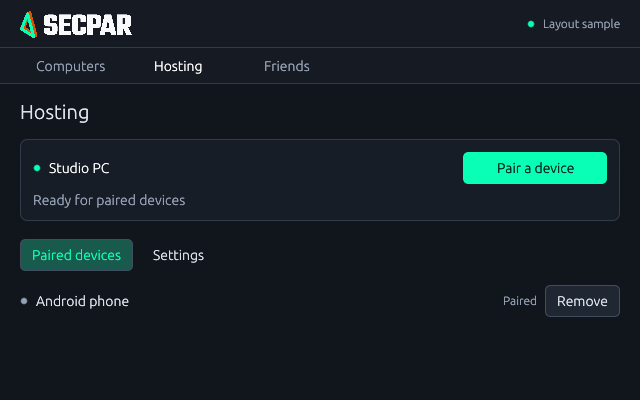

# Secpar

A fork of [PC Remote](https://github.com/SadikTD/pc-remote) for docked Android use and a growing desktop app family. Secpar focuses on physical keyboard/mouse input, resolution handling and compact, plain interfaces. Android stays client-only. Desktop hosting and connecting on Windows, Linux and macOS is the target; the current platform limits are listed below.

## Secpar for Windows — Development 5

[Download Secpar for Windows](https://github.com/modnite/Secpar/releases/download/v0.1.0-secpar-desktop-dev.5/Secpar-Windows-x64-setup.exe) · [Release notes and checksum](https://github.com/modnite/Secpar/releases/tag/v0.1.0-secpar-desktop-dev.5)

One application hosts and connects. Open **Computers** to connect to another computer, or **Hosting → Pair a device** to let Android or another desktop connect to this computer. Android uses the same hosting engine as desktop clients.

The installer includes the application and its background hosting service. It preserves existing Secpar pairings and replaces the older Secpar Host listing. **Installing restarts the service; wait until you have backup access if this is your only remote connection.** PC Remote remains separate.

Linux and macOS applications must also host and connect through one interface. Their hosting backends are unfinished, so this release does not offer client-only desktop packages. Friend streaming/multiplayer and some host controls also remain unfinished. See [implementation and validation limits](desktop/README.md).

The image is a rendered layout sample. [More screenshots and review details](docs/ui-review.md).

## Android Preview 14

[Android APK](https://github.com/modnite/Secpar/releases/download/v3.0.3-secpar-preview.14/Secpar-preview14.apk) · [Release notes](https://github.com/modnite/Secpar/releases/tag/v3.0.3-secpar-preview.14)

Android supports docked keyboard/mouse, cursor capture/release, trackpad fallback, remote pairing links and revised resolution handling. It stays client-only. Preview 12 fixed release scanner initialization; Preview 13 adds cropped decoding and focused still capture for dense QR codes, and directs setup to the desktop Hosting page. The exact host QR link was read through the isolated emulator camera and returned to the app in an instrumented test. The user confirmed built-in scanning and pairing on the Galaxy S23 with Preview 13 on November 5, 2026. Account/friend integration remains unfinished. Preview 14 adds bounded, display-paced video presentation and keyframe recovery after decoder backlog. Audio processing is unchanged; real S23 smoothness still needs comparison. Install over existing previews to preserve pairings. See [Android fork changes](docs/dock-input.md).

These are prereleases, installed manually. Android is debug-signed; Windows builds are unsigned; Mac development bundles are ad hoc signed and not notarized. GitHub's latest-stable endpoint excludes prereleases, so use these direct download links or the repository's Releases page.

## Current capabilities and limits

- **Windows host:** native capture and GPU encoding, audio, input, file/clipboard transfer, optional power and lock-screen controls, and direct/relay routing. The existing engine still has one active stream.
- **Android:** client-only. Physical input and trackpad fallback are retained. Account/friend integration is not implemented yet.
- **Desktop application:** Windows hosts and connects in one installation. Portable connection code also builds on Linux/macOS, but their hosting backends are unfinished and those client-only builds are not current public products. Only the last paired computer is currently remembered. Real hardware/network validation remains incomplete.
- **Accounts:** email/password registration, verification and browser sign-in are live at [accounts.secpar.win](https://accounts.secpar.win/auth/sign-in) and were confirmed by the user. No passkey or biometric requirement. Native Windows sign-in was also user-confirmed; friend actions and Linux/Mac native sign-in still need real-user validation.
- **Friends and sharing:** explicit friendship is separate from permission to use a PC. The API supports guest requests, permission subsets and short-lived admission grants, and cryptographically proven Windows host enrollment is implemented. Host guest admission and permission enforcement remain unfinished. No friend Connect button or multiplayer claim is presented before that works.
- **Desktop unification:** Windows has one hosting/client UI and combined installer. Linux/macOS hosting is unfinished. All nine desktop host/client combinations plus Android-to-each-host remain the target.

The Secpar background hosting service retains separate ports, protected storage and installer identity from PC Remote. Existing remote profiles can continue using the original rendezvous relay. The Secpar account service does not carry the video stream. Our own relay is reserved for a later migration; switching one side prematurely can strand existing pairings.

The project descends from Moonlight/Sunshine work, but its current PRS streaming engine directly uses Windows capture, encoding, service and input APIs. Portable protocol/client libraries exist; Linux/macOS hosting still requires platform-specific implementation. See the [architecture](docs/desktop-expansion.md) and [delivery record](docs/delivery-status.md).

## Build

- **Android:** Android SDK and a compatible JDK; `./gradlew :app:assembleNonRootRelease`.
- **Windows host:** Rust/MSVC, Node and Visual Studio C++ build tools; run `npm ci` and `npm run tauri build` in host. [Host instructions](host/README.md).
- **Desktop clients:** Rust, C/C++ tools and CMake; `cargo run --manifest-path desktop/Cargo.toml`. Linux additionally needs audio, window-system and DBus development libraries. [Desktop instructions](desktop/README.md).
- **Account service:** Cloudflare Workers + D1 and a verified email sender. [Setup and security boundaries](cloud/accounts/README.md).
- **Rendezvous service:** [Protocol and configuration](docs/remote-protocol.md). Production endpoint migration and TURN provisioning remain separate work.

Windows and Linux CI use dedicated self-hosted runners; Mac builds use GitHub runners. Test success is not a claim that every hardware/platform combination is supported. Avoid testing a new host/client pairing through your only active remote session.

Protocol references: [control](docs/protocol.md), [stream](docs/stream-protocol.md), [remote access](docs/remote-protocol.md).

## License and attribution

GPL-3.0. Original project: [SadikTD/pc-remote](https://github.com/SadikTD/pc-remote). Secpar retains upstream attribution and documents fork changes separately. Secpar is an independent project.
