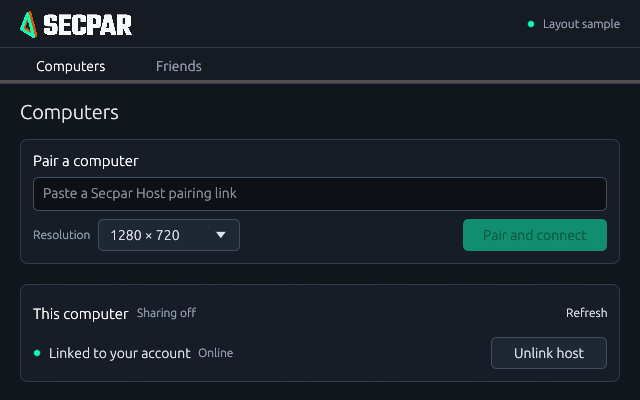
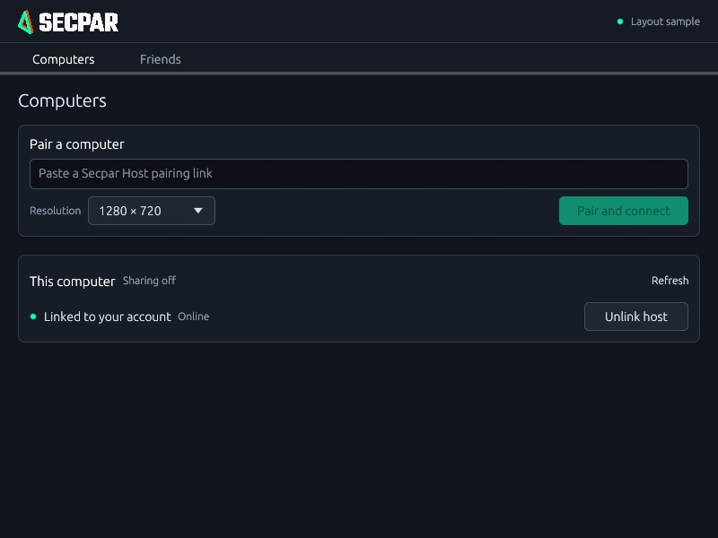
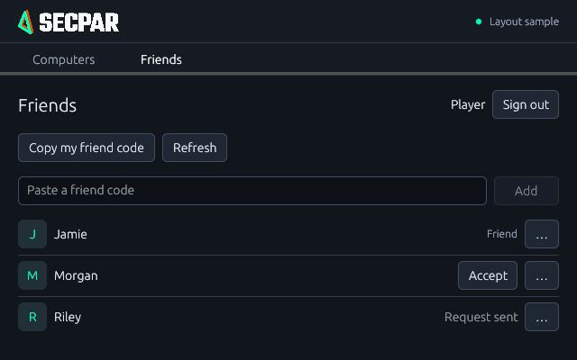
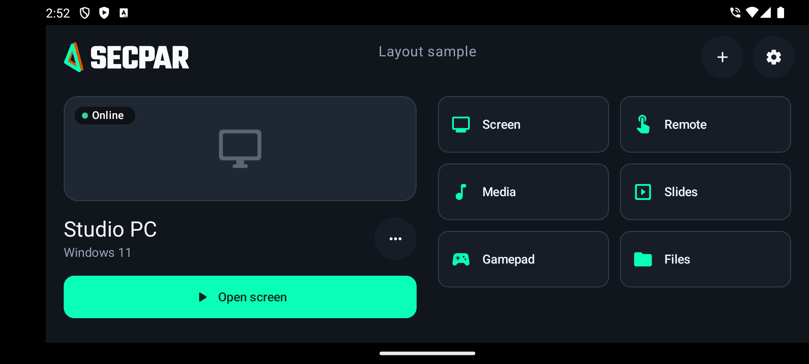
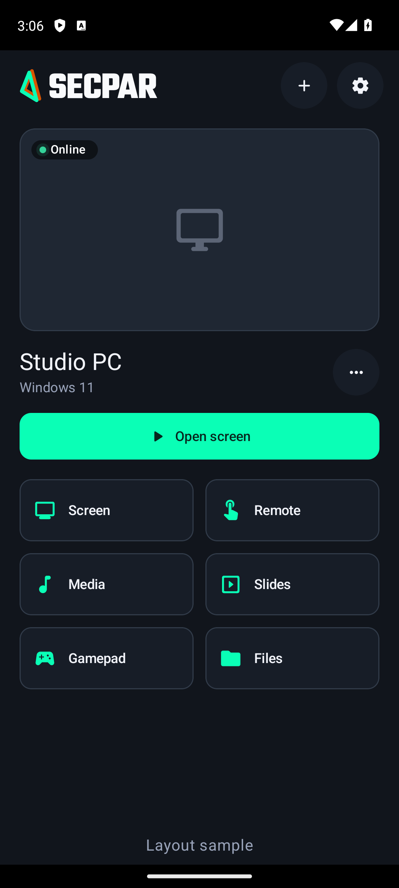
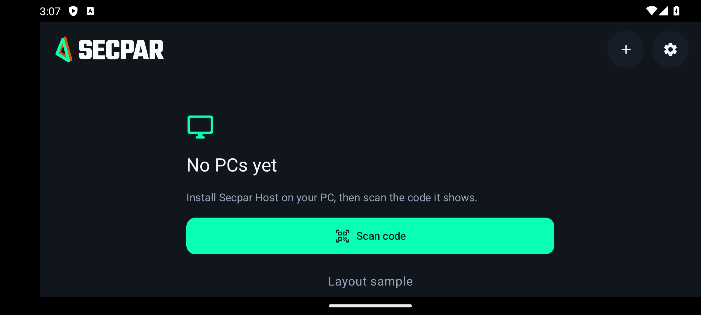
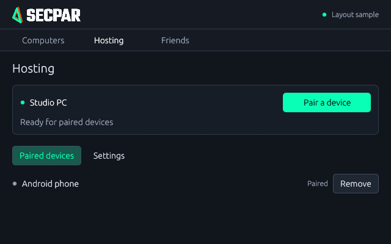
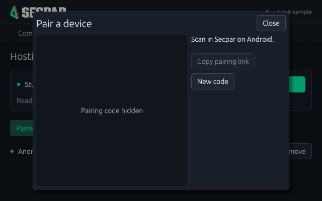
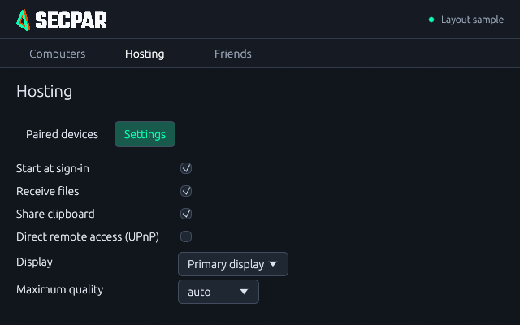

# Compact interface review

Reviewed on 2026-11-05. These images are actual rendered interfaces, not design mockups.
Desktop captures come from the native renderer. The Friends list sample uses fictional
names and is marked Layout sample; it does not claim a live account session.

Host screenshots use the actual frontend with a development-only sample bridge;
the QR code is hidden. No installed host/service was changed or restarted.

The main host panel measured zero overflow at 640×400 on Home and Settings, compared
with 138px of settings overflow before the two-column layout. Primary controls remain
visible. Desktop friend lists and host device lists scroll locally. Twelve-device Home
and Devices samples at 640×400/800×600 measured zero main-panel/horizontal overflow;
keyboard navigation to device 12 scrolled only the device list. At widths below 560px host settings falls back to
one column and may scroll. Readable text is preserved rather than uniformly shrinking
controls. Actual high-DPI hardware/macOS/Linux reviews remain required.

To reproduce the host preview, run `npm run dev` in host and open
`http://127.0.0.1:1420/layout-review.html`. It supplies sample state only and never
contacts a real host. It is not a production Vite entry point. The ordinary app loads
index.html with the real Tauri bridge. Desktop capture instructions are in desktop/README.md.

The account-linked host section was reviewed at 640×400 using the native renderer.
This is sample account state, not proof of installed-host enrollment.

## Visual polish pass

Shared control heights and center lines replace the mixed default button/dropdown
sizes. Page margins, panel padding, right-hand actions and section borders follow
consistent keylines. The normal desktop layouts fit at 640×400; Friends retains
local list scrolling. These are native-rendered sample states.

Android Home now places the PC preview/primary action and the mode grid in two
columns when the window is at least 700dp wide and landscape. Preview height
reserves room for the identity and Open screen action in short windows. Mode
controls use compact rows; shared Material primary/secondary buttons have a 48dp
minimum height. The debug-only fixture uses a sample PC and no network or pairing
store. It is excluded from the release APK.

Portrait and the unpaired landscape state were also checked on the isolated
Secpar-UI-Review emulator. Primary actions fit without scrolling in these sample
states. The sample marker belongs only to the debug fixture.

The current desktop direction was approved by the user on 2026-11-05. Retain its
shared control heights, restrained surface contrast and aligned section/action
edges when adding features. Flat should not mean the unstyled toolkit defaults.

## Desktop Development 5 hosting consolidation

The Windows desktop application now manages the same host engine used by Android
and desktop clients. Hosting includes pairing, paired devices and settings; account
linking is under Hosting → Settings. These screenshots are fictional layout states,
with the pairing image deliberately hidden. No real QR credentials are displayed.

The renderer now requests its screenshot after twelve frames instead of relying
on eframe's two-pass export, which could capture an unsettled frame or an icon
viewport. Normal app builds contain no screenshot fixtures or test networking.
Read-only state/settings calls to the installed Windows service passed. Installing
the combined package, tray interactions and real Android pairing need user checks
with backup remote access; no installed service was restarted for this review.
Linux/macOS hosting and friend sessions are still unfinished.
