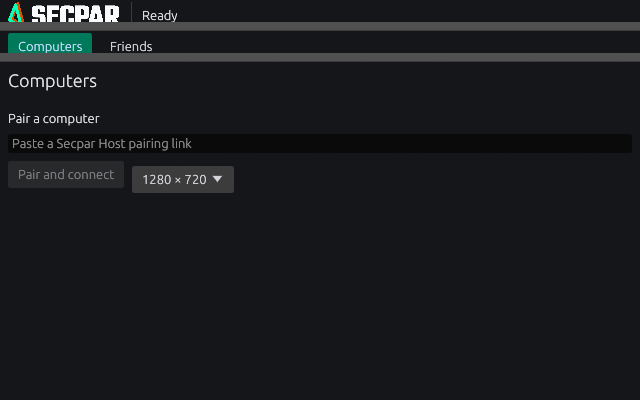
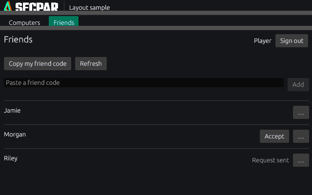
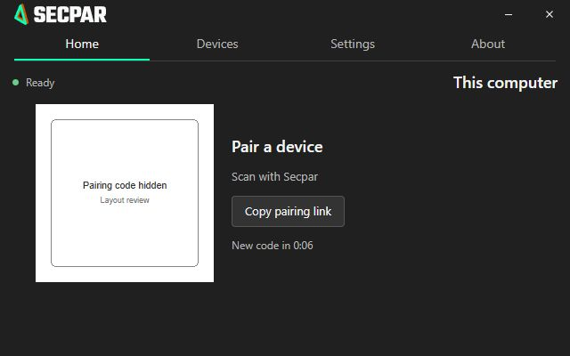
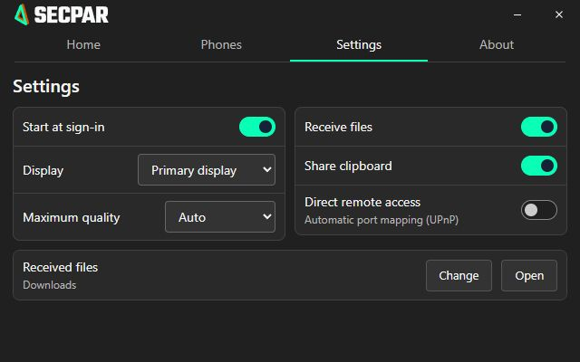
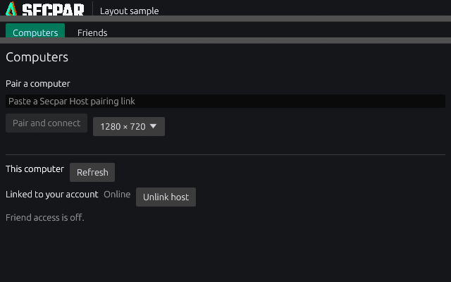
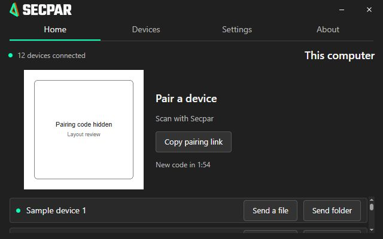
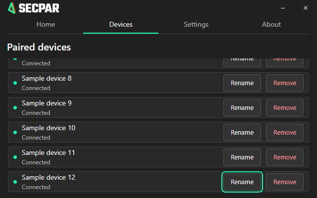

# Compact interface review

Reviewed on 2026-11-05. These images are actual rendered interfaces, not design mockups.
Desktop captures come from the native renderer. The Friends list sample uses fictional
names and is marked Layout sample; it does not claim a live account session.

Host screenshots use the actual frontend with a development-only sample bridge;
the QR code is hidden. No installed host/service was changed or restarted.

The main host panel measured zero overflow at 640×400 on Home and Settings, compared
with 138px of settings overflow before the two-column layout. Primary controls remain
visible. Desktop friend lists and host device lists scroll locally. Twelve-device Home
and Devices samples at 640×400/800×600 measured zero main-panel/horizontal overflow;
keyboard navigation to device 12 scrolled only the device list. At widths below 560px host settings falls back to
one column and may scroll. Readable text is preserved rather than uniformly shrinking
controls. Actual high-DPI hardware/macOS/Linux reviews remain required.

To reproduce the host preview, run `npm run dev` in host and open
`http://127.0.0.1:1420/layout-review.html`. It supplies sample state only and never
contacts a real host. It is not a production Vite entry point. The ordinary app loads
index.html with the real Tauri bridge. Desktop capture instructions are in desktop/README.md.

The account-linked host section was reviewed at 640×400 using the native renderer.
This is sample account state, not proof of installed-host enrollment.

